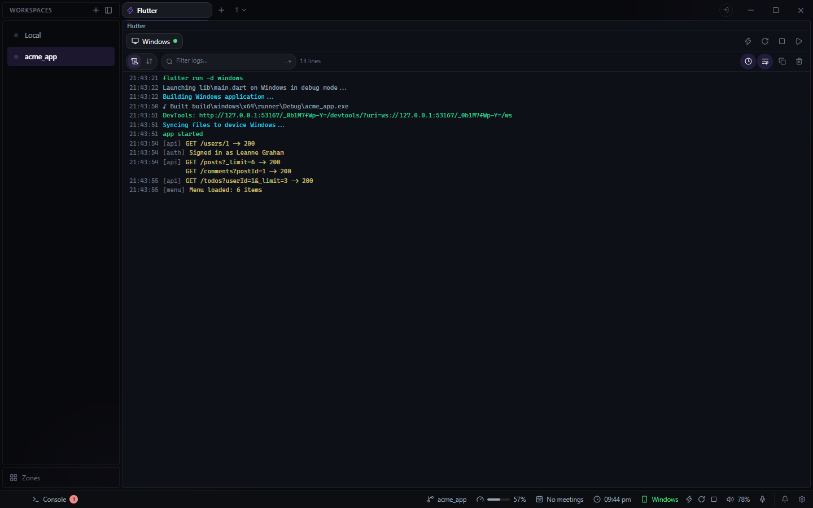
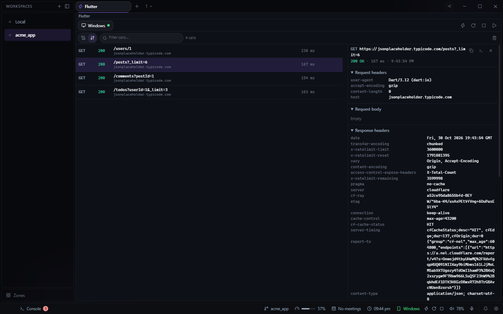

# Flutter for Deck

Launch a Flutter app on a device, then hot reload it without leaving Deck. It lives in the footer:
a readout with the running app and its buttons, and a **Flutter** panel beside Console in the
footer drawer, which shows while the workspace is a Flutter project or an app is running.

## Running an app

- **Run** from the footer or the panel: pick the app (a workspace with several, such as a package
  and its `example/`, lists each) and a device.
- **A `flutter run` typed in a terminal** is found by itself, and the footer's buttons work for it
  too.
- **Hot reload, hot restart and stop** from the footer, the panel, or the command palette.
- **Saving a file** hot reloads the app that file belongs to.
- A run shows in every workspace whose folder holds it. A run started from Deck sends a
  notification when it exits, crashes or cannot start, unless you stopped it.
- A run started from Deck is offered to Deck's debugger to attach to.

## The log

The panel reads Flutter's output: `developer.log` records, stack frames whose files open in the
Editor, and framework errors apart from ordinary prints. Filter it (a `/regex/` too), wrap long
lines, switch between the app's time and Deck's, copy what is shown, or clear it. The same panel
can be opened as a pane, to keep it on screen.

`developer.log` lines and the Network view need a run started from Deck. A run typed in a
terminal gets the buttons only; its output stays in its terminal.

## Network

The **Network** view lists the app's HTTP calls: method, status, timing, size, headers and
bodies, with copy as cURL. They come from the VM Service's dart:io HTTP profile, the same source
as the Network tab in Flutter's DevTools, so the app needs no interceptor or package. It covers
anything built on dart:io's `HttpClient` (package:http, dio's default adapter); not Flutter web,
native adapters such as `cupertino_http` or `cronet_http`, or native SDKs. A call made before the
plugin attaches to the app, in the first moments of `main`, is not recorded.

## For agents

The plugin brings `flutter_*` tools to Deck's MCP server: `flutter_list` (the apps running and the
devices), `flutter_run`, `flutter_reload`, `flutter_restart`, `flutter_stop`, and `flutter_log`
for a Deck-run app's output. The apps Deck is running are listed in `plugin-flutter-runs.json` in
Deck's config, which is how the tools find them.

**Needs** the Flutter SDK on PATH.
